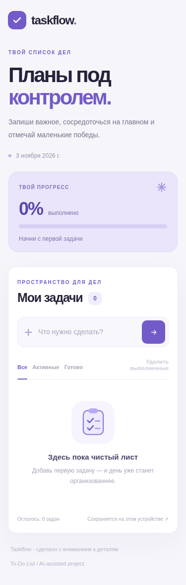

# Taskflow — список задач

Адаптивное веб-приложение To-Do List на **HTML, CSS и JavaScript**. Создано с использованием AI-инструментов в рамках тестового задания на стажировку веб-кодера.

## Предпросмотр


<details>
<summary>Мобильная версия</summary>



</details>

## Возможности

- Добавление новых задач (кнопкой или Enter).
- Отметка задач выполненными и возврат в активные.
- Удаление отдельных задач.
- Автоматическое сохранение списка в `localStorage`: задачи не исчезают после обновления страницы.
- Дополнительно: фильтры «Все / Активные / Готово», прогресс выполнения, массовое удаление выполненных задач и адаптивная верстка.

## Как запустить

Никакой установки зависимостей не требуется.

1. Скачайте репозиторий.
2. Запустите простой локальный сервер из папки проекта (это надёжнее, чем открывать HTML по адресу `file://`):

```bash
python -m http.server 8000
```

3. Откройте `http://localhost:8000` в браузере. В Windows вместо `python` при необходимости используйте `py`.

## Проверка функционала

1. Добавьте задачу → она должна появиться в списке.
2. Отметьте её выполненной → изменится статус и прогресс.
3. Перезагрузите страницу → текст и статус сохранятся.
4. Снимите отметку / удалите задачу → изменения сохранятся и после перезагрузки.
5. Проверьте фильтры и страницу на мобильном экране.

## Технологии

- **HTML5** — разметка и доступные элементы управления.
- **CSS3** — стили и адаптивная верстка.
- **JavaScript (Vanilla JS)** — логика приложения и обработчики событий.
- **Web Storage API** — хранение массива задач в `localStorage` в формате JSON.

Приложение работает без сервера, базы данных, React и платных API. Данные сохраняются **в конкретном браузере/устройстве**, а не синхронизируются между устройствами.

## Использование AI

**ChatGPT (OpenAI)** — помощь с планированием, генерацией стартовой версии, улучшением интерфейса, обработкой крайних случаев и проверкой функционала. Финальный код и поведение приложения должны быть проверены автором перед отправкой тестового задания.

## Структура проекта

```text
index.html   — HTML-разметка
styles.css   — внешний вид и адаптивность
app.js       — логика задач и localStorage
favicon.svg  — иконка вкладки
README.md    — описание и инструкции
preview.png  — скриншот на компьютере
preview-mobile.png — скриншот на телефоне
```

## Публикация на GitHub Pages

В репозитории откройте **Settings → Pages → Build and deployment**. Выберите **Deploy from a branch**, ветку **main** и папку **/(root)**, затем **Save**. После публикации GitHub покажет URL работающего сайта.

## Автоматические проверки

Если установлен Node.js, выполните из папки проекта:

```bash
node --check app.js
node --test app.test.cjs
```

Установка пакетов не нужна. Тесты используют встроенные модули Node.js и имитацию DOM/localStorage. Они проверяют основные операции, фильтры, прогресс, восстановление после перезагрузки, уникальность ID, ошибки хранилища и переходы фокуса. Эти проверки не заменяют проверку в настоящем браузере.

## Проверка клавиатуры и крайних случаев

- Через Tab перейдите к полю ввода, добавьте задачу клавишей Enter.
- Через Tab перейдите к флажку, нажмите Space: фокус должен остаться на нём.
- В фильтре «Активные» отметьте задачу: фокус перейдёт на соседнюю видимую задачу, а при пустом списке — в поле ввода.
- Удалите задачу через Enter или Space на кнопке удаления: фокус перейдёт на кнопку удаления следующей задачи, либо предыдущей, если удалена последняя. При пустом списке он вернётся в поле ввода.
- Проверьте фильтры и удаление выполненных с клавиатуры. После массового удаления фокус вернётся в поле ввода.
- Проверьте ширины 320, 375, 720 и 1280 px, длинные задачи и длинное уведомление об ошибке: не должно быть горизонтальной прокрутки или перекрытия элементов. Кнопка добавления имеет доступное имя и в виде одной иконки.

При ошибке чтения хранилища показывается предупреждение; исходный список не перезаписывается, изменения остаются только в памяти до перезагрузки. После исправления настроек браузера перезагрузите страницу. При повреждённых данных восстанавливаются пригодные записи и исправляются повторные/пустые ID; исправленный список записывается при следующем изменении. Если весь список нечитаем, уведомление предупреждает, что первое изменение заменит повреждённые данные новым списком.

При ошибке записи интерфейс продолжает работать и предупреждает, что последние изменения могут пропасть. Следующее изменение повторяет попытку сохранения; после успешной записи предупреждение скрывается.
